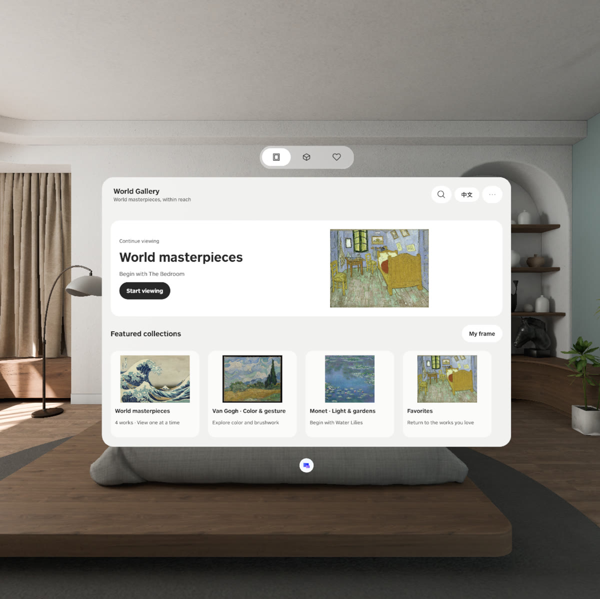
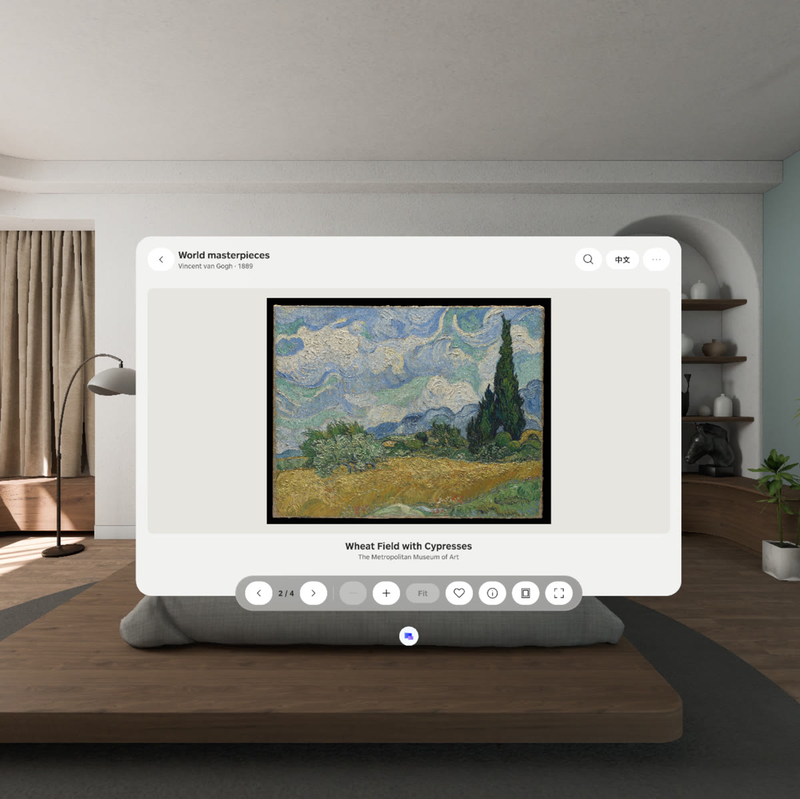
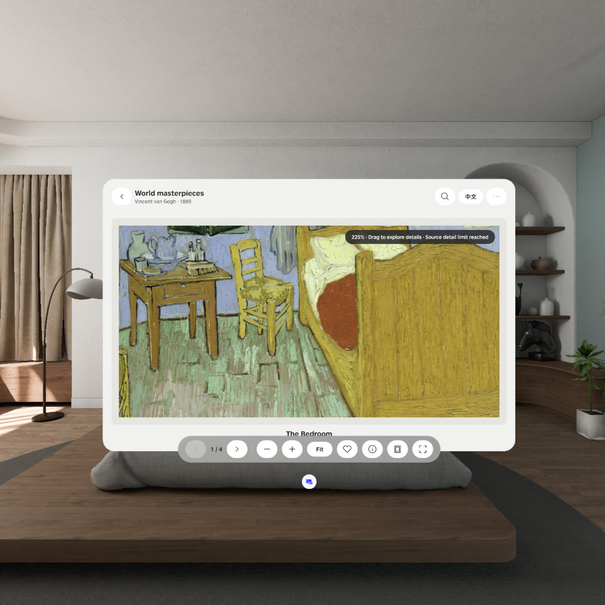
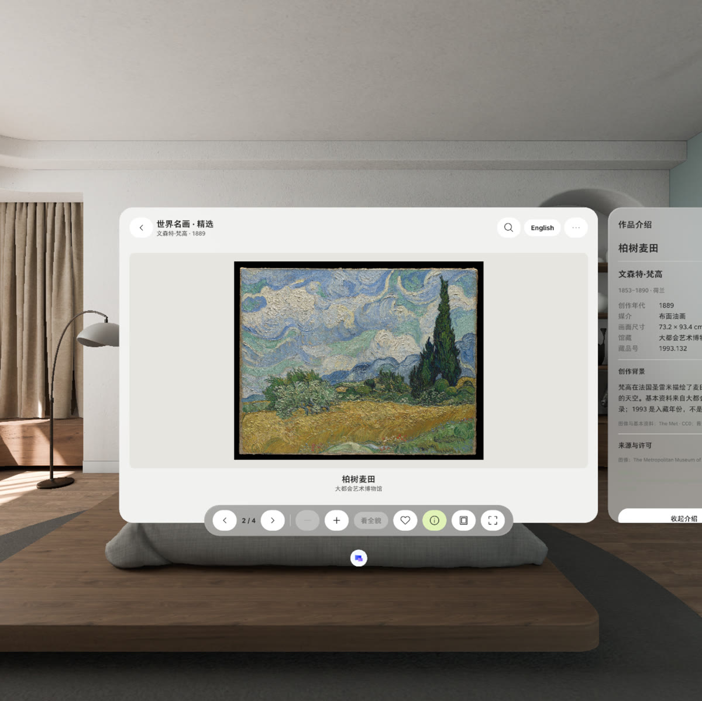
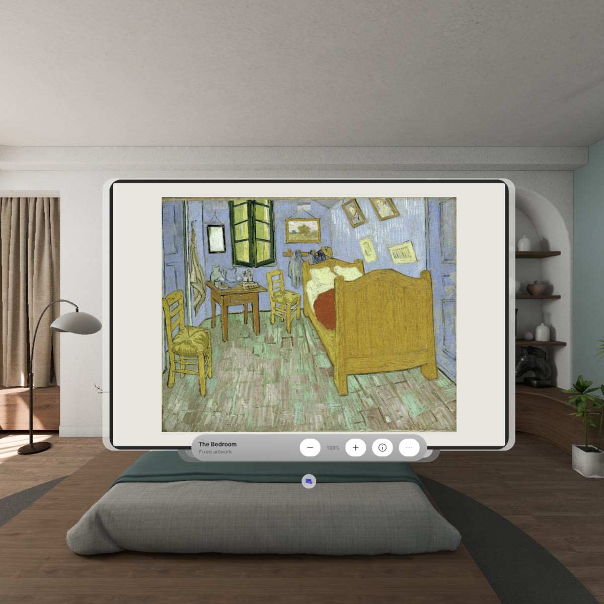
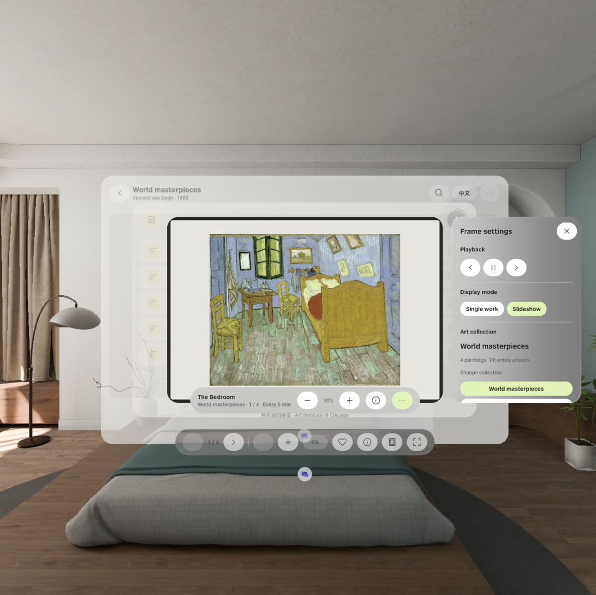
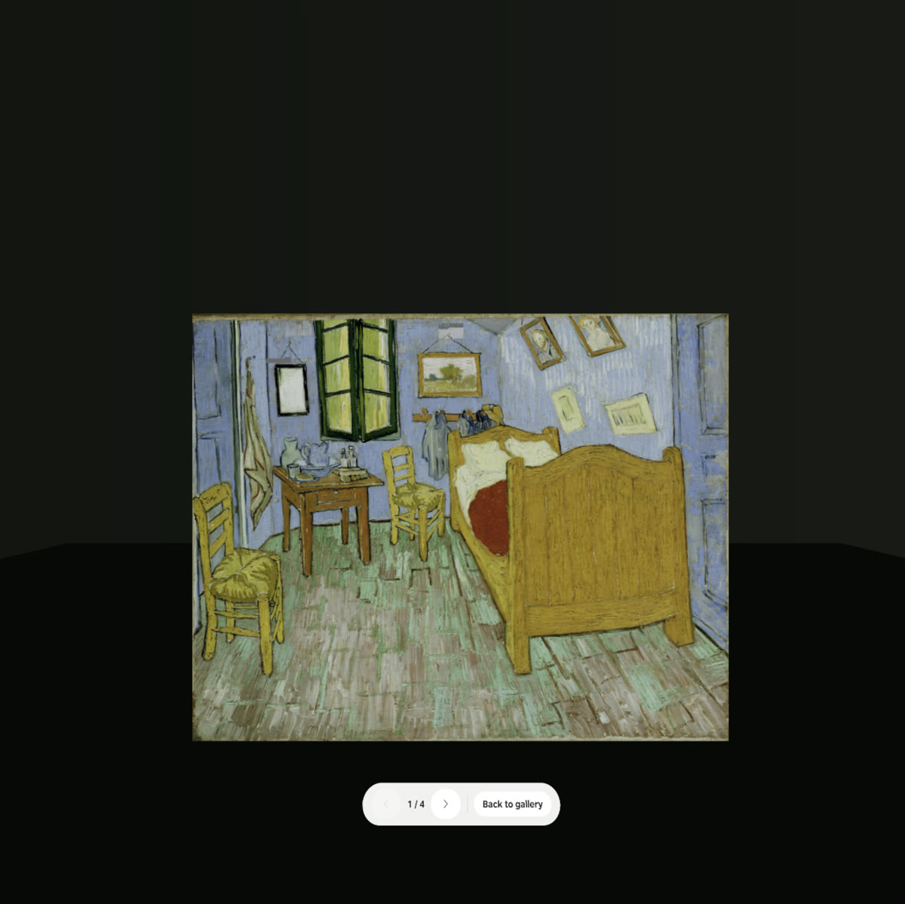
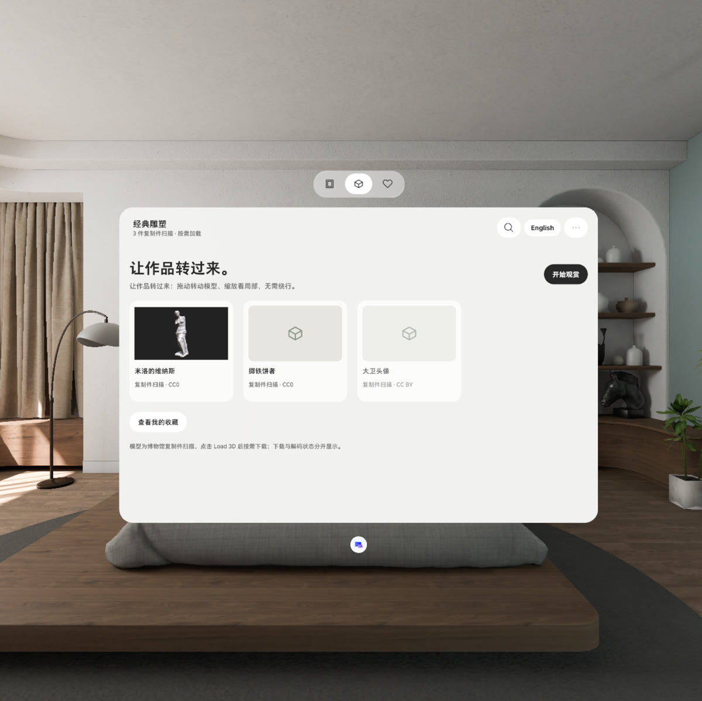

# World Gallery

English · [中文](README.md)

Sit where you are and look closely at the world's masterpieces, one work at a time. World Gallery is a PICO OS 6 Spatial SDK app (Kotlin + Jetpack Compose + Spatial ECS): browse and view paintings and sculptures in a Shared Space planar window, hang a favourite as its own art-frame window, or step into Full Space where only the current work remains in a dark scene. Works offline; progress, favourites and settings are stored on the device; Chinese and English UI. Built from the [PRD v0.4](https://bytedance.us.larkoffice.com/docx/BY6odKmi9o06zGxHAR9uAUy4sUc) and the [Figma file](https://www.figma.com/design/KyputdjwUDJB3ZUrxLtPRI/World-Gallery).

Demo (PICO Emulator, 49 s; the emulator repaints at ~1 Hz when idle, so it plays like a slideshow): [`deliverables/WorldGallery-demo.mp4`](deliverables/WorldGallery-demo.mp4)

<table>
<tr>
<td><br><sub>Home: continue viewing, featured collections, Paintings / Sculpture / Favorites tabs</sub></td>
<td><br><sub>Viewer: original aspect, previous / next, zoom, favourite, info, set as frame, immerse</sub></td>
</tr>
<tr>
<td><br><sub>Zoomed to the source's detail limit; drag to explore</sub></td>
<td><br><sub>Tap the work or ⓘ for the info subwindow: museum facts, background, source and licence (Chinese UI)</sub></td>
</tr>
<tr>
<td><br><sub>Art frame: its own window in the room, − / + resizes it in one tap (50–160 %)</sub></td>
<td><br><sub>Frame settings: playback, single work / slideshow, collection, interval and order</sub></td>
</tr>
<tr>
<td><br><sub>Full Space: only the work in a dark scene; the strip below turns pages or goes back to the gallery</sub></td>
<td><br><sub>Sculpture collection: models load on demand; drag to rotate, pinch to scale</sub></td>
</tr>
</table>

## Features

- **Browse**: continue viewing, featured collections, bilingual search, local favourites; Paintings · Sculpture · Favorites tabs.
- **View one work at a time**: paintings sit on a plain mat at their original aspect; drag to pan, zoom with buttons or a two-hand pinch, "Fit" to see the whole work; a hint appears when you zoom past the source image's resolution; previous / next cross-fades between pictures instead of flashing. Sculptures: drag to rotate, front / side / back, reset view.
- **Info window**: tap the work or the toolbar ⓘ for a subwindow with museum facts, background text, separate image / model / text licences and a link to the collection page; it follows page turns.
- **Art frame**: set the current work as a separate frame window (one frame only; replacing asks first); a fixed work or a slideshow of a collection / favourites at 1 / 5 / 15 / 60 min, in order or shuffled; pauses while you read the info, while minimized and in Full Space. The bar keeps title, − / + size, info and settings; transport controls live in the settings panel.
- **Full Space**: a dark gradient scene with the current work and one control strip beneath it — previous / next / back to gallery; drag to pan or rotate, pinch to zoom. Leaving returns the gallery window on the same work.
- **Sculpture Load 3D**: `not loaded → downloading → verifying → loading → interactive`, cancellable and retryable; the next sculpture in the queue is prefetched.
- **Persistence**: queue position, per-work zoom / pan / angle, favourites, frame settings, language.

## Download and install

- **APK**: [GitHub Releases](https://github.com/kejing-dev/WorldGallery/releases) (`WorldGallery-v<version>.apk`, a release build signed with the Android debug key so it installs as-is).
- Install on a PICO OS 6 device or PICO Emulator 6.1:

```bash
adb install -r WorldGallery-v1.0.0.apk
adb shell monkey -p com.worldgallery.spatial -c android.intent.category.LAUNCHER 1   # or open World Gallery from the launcher
```

  `pico-cli app install WorldGallery-v1.0.0.apk` and `pico-cli app launch com.worldgallery.spatial` work too. With several devices attached add `adb -s <serial>`.

## One app, three spatial containers

| Container | Declared in | Role |
| --- | --- | --- |
| `DefaultWindowContainer` (Planar, 1134 × 748 dp, id `WorldGalleryMain`) | `AndroidManifest.xml` | Home / collection / viewer / favourites / search; TitleBar, window-level TabBar and viewing Toolbar; the info window is a right-hand `Subwindow` |
| `WindowContainer` (Planar, default 1094 × 740 dp, id `WorldGalleryFrame`, no glass) | `Main.kt` DSL | Art frame; `ContainerResizeType.ContentSize` + `Modifier.windowConstraints` let the − / + buttons drive the window size |
| `Stage` (Full, immersion 100, id `WorldGalleryImmersive`) | `Main.kt` DSL | Immersive viewing: scene + current work + one `AttachmentPanel` control strip |

Shared Space and Full Space share one `ViewingSession` (queue, index) and each work's `ViewState`. When the Stage opens it minimizes this app's Shared Space windows (the gallery and an open frame); "Back to gallery" restores them with `restoreWindowContainer` **before** `closeStage()`. The SDK allows minimize / restore only while a Stage is open, and once the Stage is closed the app is in the background and can neither restore, reopen nor relaunch its window (measured on the emulator), so the order matters. The system only lets an app open a Stage while its window has focus (`NotAllowed` otherwise). The debug switch `reopenMode <minimize|context|navigator|intent>` selects the tutorial's close-and-reopen variants for A/B on a device.

All 2D UI is SpatialUI (`com.pico.spatial.ui.*`) inside `PicoTheme` (Figma semantic colours + PICO Sans); no Material.

## Content and licences

`app/src/main/assets/` ships four open museum images (≤ 4096 px on the long edge, never upscaled): *The Bedroom* and *Wheat Field with Cypresses* (AIC / The Met, Public Domain / CC0), *The Great Wave off Kanagawa* and *Water Lilies* (AIC). The sculpture entries (Venus de Milo, Discobolus, Head of David) are SMK / Thomas Flynn cast scans loaded on demand: Sketchfab downloads need a signed-in account, so place the file at the app's `files/models/<id>.glb` (or `/sdcard/Android/data/com.worldgallery.spatial/files/models/`), or point the debug command `modelUrl <id> <url|file://…>` at a source.

## Build

```bash
export JAVA_HOME=~/.pico/primer-cli/jdk/jdk-21.0.12.1+1/Contents/Home
./gradlew :app:assembleDebug        # debug build with the adb debug channel
./gradlew :app:assembleRelease      # release build (debug-key signed) — this is what Releases ship
```

PICO Spatial SDK 6.1.9 (BOM), Kotlin 2, compileSdk 35.

## Debug channel (debug builds only; the emulator cannot script spatial input)

```bash
adb shell am broadcast -a com.worldgallery.spatial.DEBUG --es cmd start --es arg essentials
adb shell am broadcast -a com.worldgallery.spatial.DEBUG --es cmd next
adb shell am broadcast -a com.worldgallery.spatial.DEBUG --es cmd immersive
adb shell am broadcast -a com.worldgallery.spatial.DEBUG --es cmd leaveImmersive
```

Other commands: `tab <paintings|sculpture|favorites>` `collection <id>` `open <artworkId>` `continue` `back` `prev` `restart` `zoomIn` `zoomOut` `fit` `pan x,y` `yaw <deg>` `rotate dy,dp` `scale <f>` `fav` `info` `closeInfo` `frame [force]` `frameLoop <collection|favorites>` `frameMode <fixed|loop>` `frameInterval <min>` `frameShuffle <on|off>` `framePause` `framePlay` `frameNext` `framePrev` `frameSettings` `frameSize <in|out|0-4>` `frameInfo` `exitImmersive` `reopenMode <minimize|context|navigator|intent>` `openFrame` `closeFrame` `load3d` `cancel3d` `retry3d` `forget3d` `modelUrl <id> <url>` `lang <zh|en>` `hintSeen` `reduceMotion <on|off>` `state` `wipe`. `deliverables/drive.py` and `deliverables/dbg.sh` wrap them and take screenshots; `deliverables/round*_test.py` are the emulator verification runs.

## Layout

- `app/src/main/java/com/worldgallery/spatial/`
  - `Main.kt` the three containers' DSL · `platform/` Application / LaunchActivity · `data/` catalogue, bilingual copy, persistence · `app/GalleryViewModel.kt` app-wide state (queue, view state, favourites, info binding, frame timer, immersion, 3D loading) · `scene/` model loader, bitmap cache, painting plane / model / immersive scene entities · `ui/` theme, icons, pages, viewer, info panel, frame window, immersive Stage · `debug/` adb test channel
- `deliverables/` drive and verification scripts, [release notes](deliverables/release-notes.md) with each round's fixes and emulator evidence
- `docs/screenshots/` the screenshots above (emulator)

## Verification status

Verified on PICO Emulator 6.1: browsing, viewing, zoom and the detail-limit hint, info window, favourites, frame (fixed / slideshow / reading pause / one-tap size), the sculpture Load 3D state machine with a side-loaded model, Full Space round-trips (two in a row, with the frame open, both restore variants), language switching.

Still to verify on a device: leaving Full Space with the system Back gesture (the emulator's `keyevent BACK` never reaches a Stage), hand / controller drag and pinch (the emulator only has the debug channel), real Sketchfab downloads (the emulator has no network).
