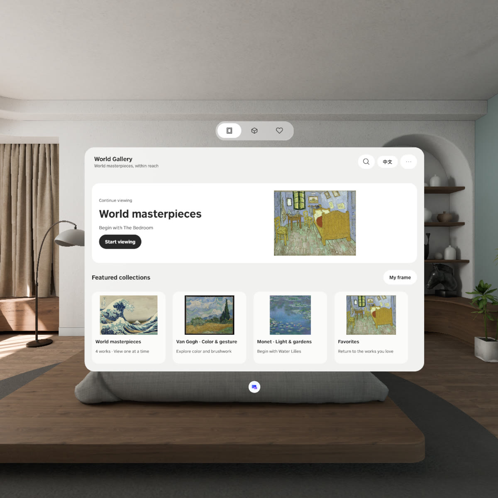
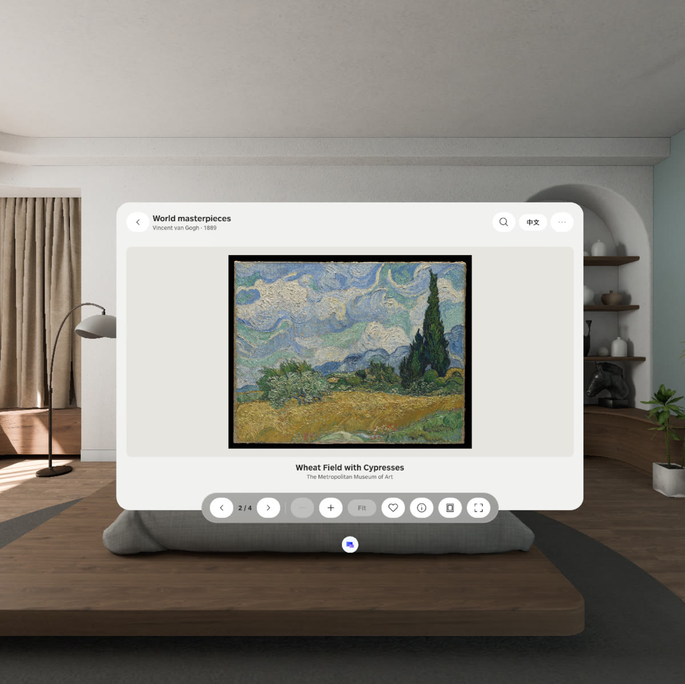
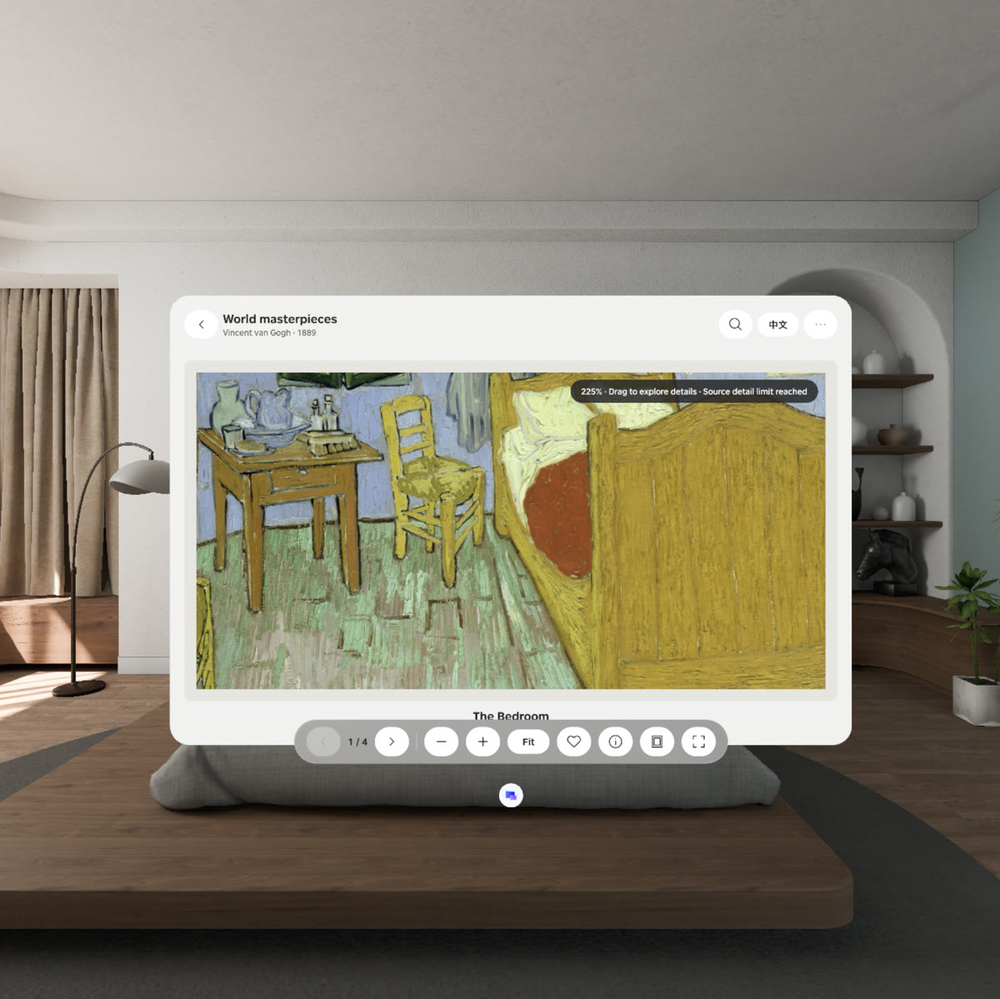
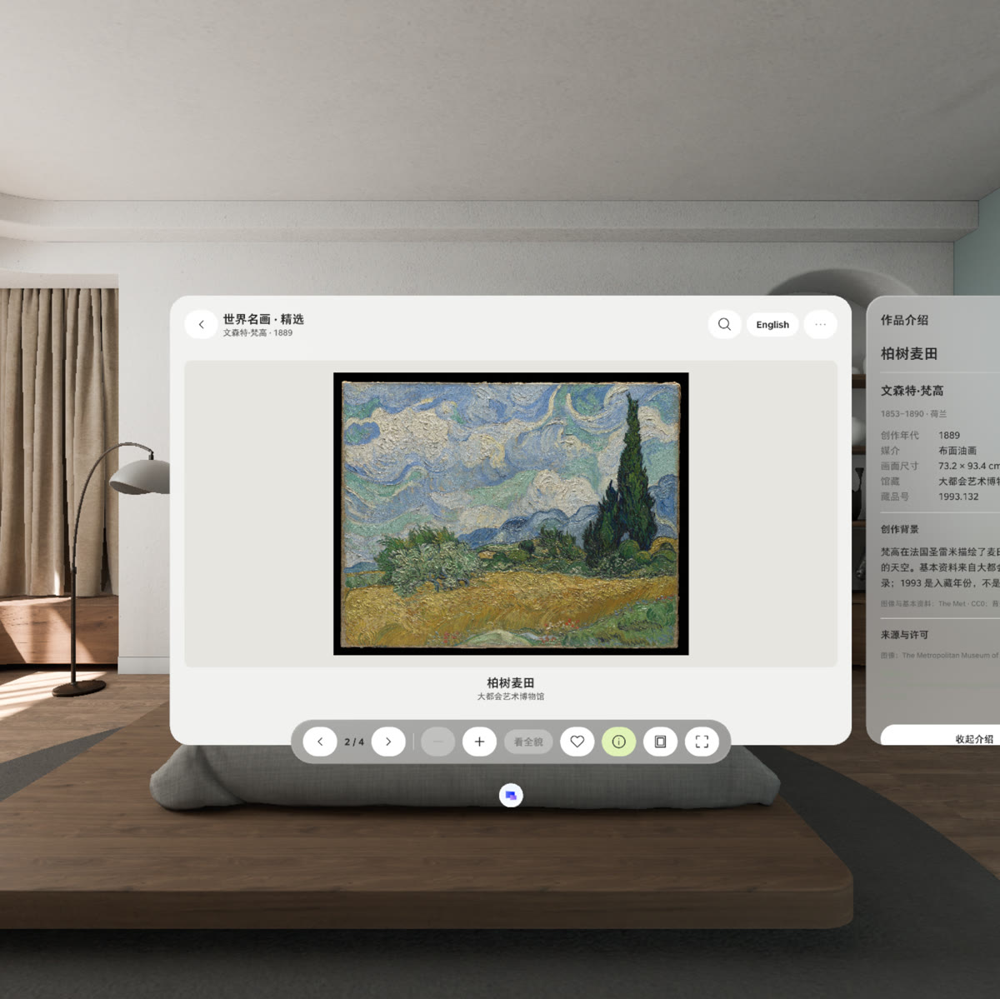
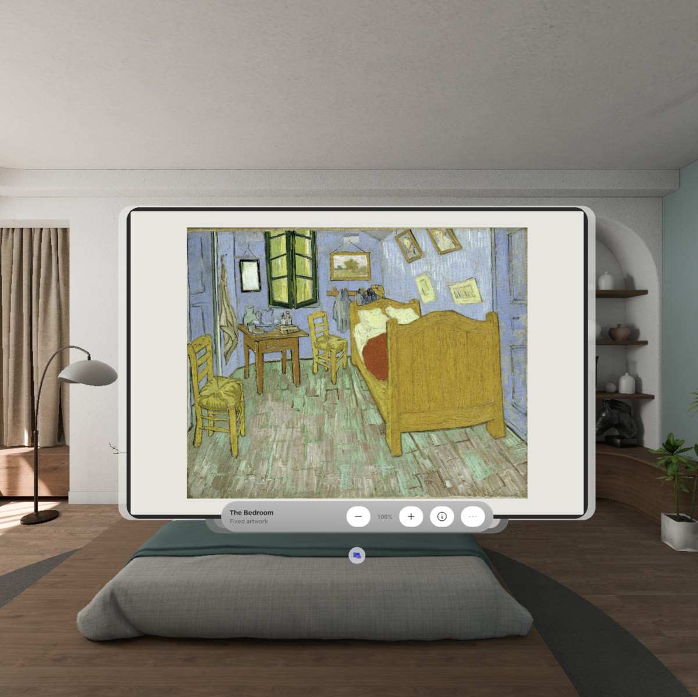
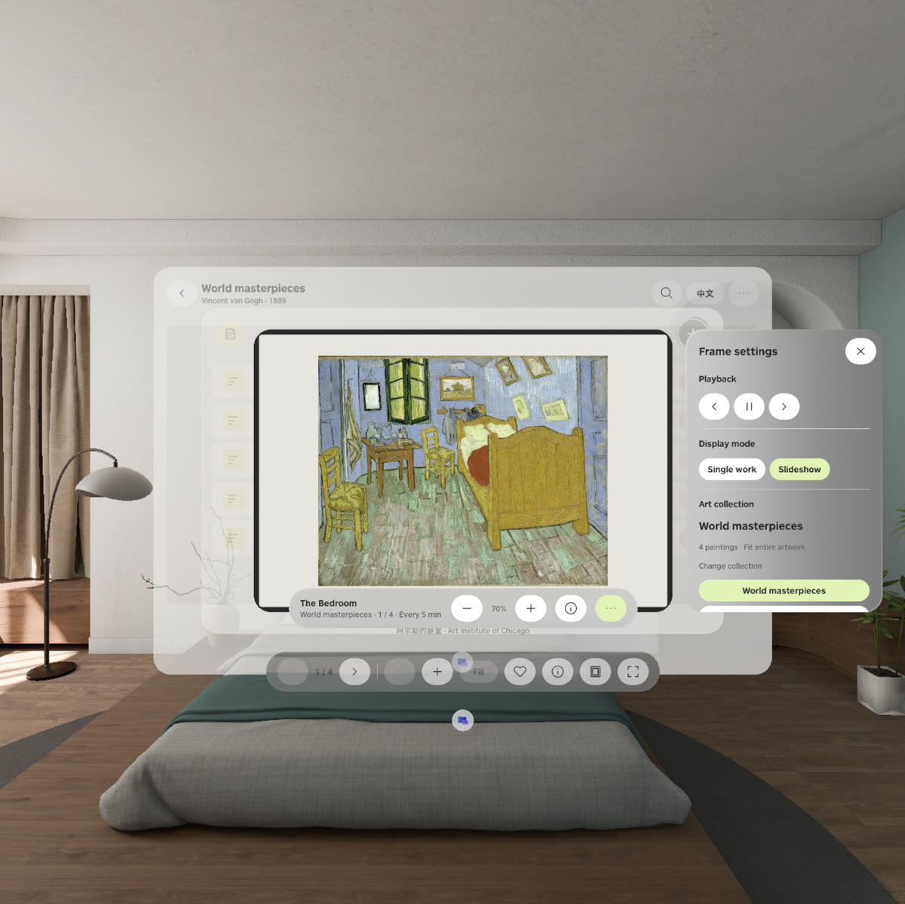
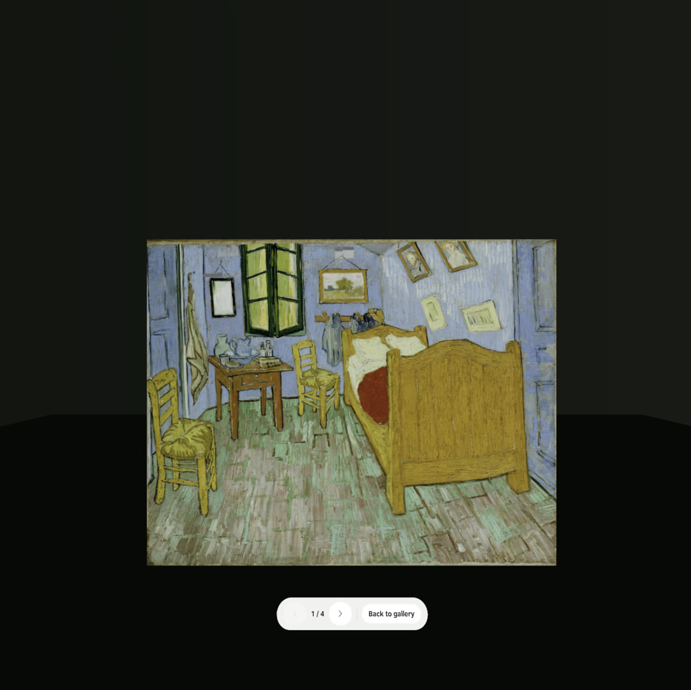
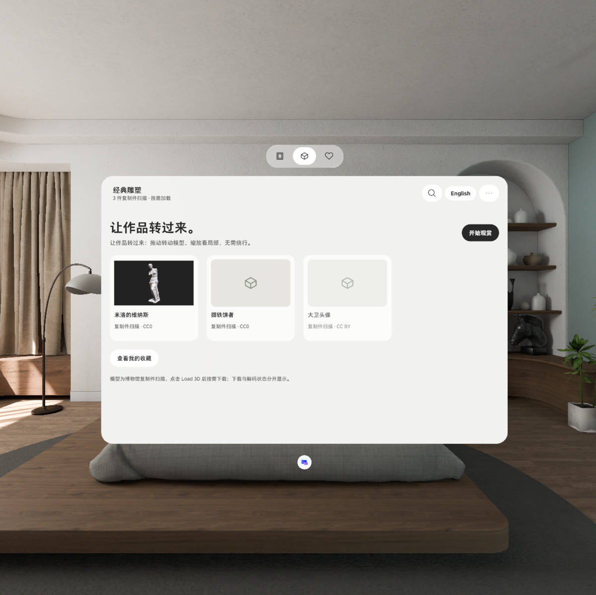

# World Gallery · 世界名画精选

[English](README.en.md) · 中文

坐在原地，一件接一件地近看世界名作。World Gallery 是一个 PICO OS 6 Spatial SDK 应用（Kotlin + Jetpack Compose + Spatial ECS）：在 Shared Space 的平面窗口里浏览、逐件观赏名画和雕塑，把喜欢的一幅挂成独立的艺术画框窗口，或进入 Full Space 在暗色场景里只留当前作品。离线可用，进度、收藏与设置保存在本机，中英双语。按 [PRD v0.4](https://bytedance.us.larkoffice.com/docx/BY6odKmi9o06zGxHAR9uAUy4sUc) 与 [Figma 设计稿](https://www.figma.com/design/KyputdjwUDJB3ZUrxLtPRI/World-Gallery) 实现。

演示视频（PICO 模拟器，49 s，模拟器空闲时显示只有约 1 Hz 刷新，所以像幻灯片）：[`deliverables/WorldGallery-demo.mp4`](deliverables/WorldGallery-demo.mp4)

<table>
<tr>
<td><br><sub>首页：继续观赏、精选合集、名画 / 雕塑 / 收藏 Tab</sub></td>
<td><br><sub>观赏页：原始比例、上一件 / 下一件、缩放、收藏、介绍、设为画框、沉浸</sub></td>
</tr>
<tr>
<td><br><sub>放大到源图细节上限时的提示，拖动查看局部</sub></td>
<td><br><sub>点作品或 i 打开右侧介绍窗口：馆藏资料、背景、来源与许可（中文界面）</sub></td>
</tr>
<tr>
<td><br><sub>艺术画框：独立窗口挂在房间里，− / + 一键改尺寸（50–160 %）</sub></td>
<td><br><sub>画框设置：播放控制、固定 / 轮播、合集、间隔与顺序</sub></td>
</tr>
<tr>
<td><br><sub>Full Space：暗色场景只留作品，下方控制条翻页或「回到画廊」</sub></td>
<td><br><sub>雕塑合集：模型按需加载，拖动转动、双手捏合缩放</sub></td>
</tr>
</table>

## 功能

- **浏览**：首页继续观赏、精选合集、中英文搜索、本地收藏；名画 · 雕塑 · 收藏三个 Tab。
- **逐件观赏**：名画在极简衬底上按原始比例显示；拖动平移、按钮或双手捏合缩放、看全貌；放大超过源图分辨率时提示「已到源图细节上限」；上一件 / 下一件切换时两张图交叉淡入淡出，不闪白。雕塑拖动转动、正面 / 侧面 / 背面、重置视图。
- **介绍窗口**：点作品或工具栏 i 打开右侧子窗口；馆藏资料、创作背景、图片 / 模型 / 文字许可分别标注，附馆藏页面链接；翻页时同步。
- **艺术画框**：把当前作品设为独立的画框窗口（只有一个画框，已有时询问替换）；固定一幅或轮播合集 / 收藏，1 / 5 / 15 / 60 分钟，顺序 / 随机；阅读介绍、窗口最小化、进入 Full Space 时自动暂停。控制条只保留作品名、− / + 一键尺寸、介绍、设置，播放控制在设置面板里。
- **Full Space**：暗色渐变场景 + 当前作品，作品下方一条控制条：上一件 / 下一件 / 回到画廊；拖动平移或转动，捏合缩放。退出后画廊窗口回到同一件作品。
- **雕塑 Load 3D**：`未加载 → 下载中 → 校验中 → 加载中 → 可交互`，可取消、重试；队列中下一件自动预取。
- **本地保存**：队列进度、每件作品的缩放 / 平移 / 角度、收藏、画框设置、语言。

## 下载与安装

- **APK**：[GitHub Releases](https://github.com/kejing-dev/WorldGallery/releases)（`WorldGallery-v<版本>.apk`，release 构建，用 Android debug 密钥签名，可直接安装）。
- 安装到 PICO OS 6 设备或 PICO 模拟器 6.1：

```bash
adb install -r WorldGallery-v1.0.0.apk
adb shell monkey -p com.worldgallery.spatial -c android.intent.category.LAUNCHER 1   # 或在启动器里打开 World Gallery
```

  也可以用 `pico-cli app install WorldGallery-v1.0.0.apk` 和 `pico-cli app launch com.worldgallery.spatial`。多台设备时加 `adb -s <serial>`。

## 一个应用，三个空间容器

| 容器 | 声明 | 用途 |
| --- | --- | --- |
| `DefaultWindowContainer`（Planar，1134 × 748 dp，id `WorldGalleryMain`） | `AndroidManifest.xml` | 首页 / 合集 / 单件观赏 / 收藏 / 搜索；TitleBar、窗口级 TabBar 与观赏 Toolbar；作品介绍为右侧 `Subwindow` |
| `WindowContainer`（Planar，默认 1094 × 740 dp，id `WorldGalleryFrame`，无玻璃） | `Main.kt` DSL | 艺术画框；`ContainerResizeType.ContentSize` + `Modifier.windowConstraints` 让 − / + 按钮直接改窗口尺寸 |
| `Stage`（Full，immersion 100，id `WorldGalleryImmersive`） | `Main.kt` DSL | 沉浸观赏：场景 + 当前作品 + 一条 `AttachmentPanel` 控制条 |

Shared Space 与 Full Space 共用同一个 `ViewingSession`（队列、序号）和每件作品的 `ViewState`。进入 Full Space 时 Stage 把本应用的 Shared Space 窗口（主窗口，以及打开着的画框）最小化；点「回到画廊」时 Stage **先** `restoreWindowContainer` 恢复窗口、**再** `closeStage()`。SDK 规定 minimize / restore 只能在 Stage 打开时调用；Stage 关闭后应用已在后台，既不能 restore，也不能 open 窗口或用启动 Intent 拉回自己（模拟器实测），所以顺序不能反。只有当本应用窗口持有焦点时系统才允许打开 Stage（否则返回 `NotAllowed`）。调试开关 `reopenMode <minimize|context|navigator|intent>` 可切换到教程式的「关闭再重开」变体做真机 A/B。

所有 2D 界面用 SpatialUI（`com.pico.spatial.ui.*`）+ `PicoTheme`（Figma 语义色 + PICO Sans），不含 Material。

## 内容与许可

`app/src/main/assets/` 内置 4 幅馆方开放图像（≤ 4096 px 长边，未放大）：《阿尔勒的卧室》《柏树麦田》（AIC / Met，Public Domain / CC0）、《神奈川冲浪里》《睡莲》（AIC）。雕塑条目（维纳斯、掷铁饼者、大卫头像）为 SMK / Thomas Flynn 复制件扫描，模型按需加载：Sketchfab 下载需要登录，取得文件后放到应用的 `files/models/<id>.glb`（或 `/sdcard/Android/data/com.worldgallery.spatial/files/models/`），或用调试命令 `modelUrl <id> <url|file://…>` 指定来源。

## 构建

```bash
export JAVA_HOME=~/.pico/primer-cli/jdk/jdk-21.0.12.1+1/Contents/Home
./gradlew :app:assembleDebug        # 调试包，带 adb 调试通道
./gradlew :app:assembleRelease      # 发布包（debug 密钥签名），Releases 里的就是它
```

PICO Spatial SDK 6.1.9（BOM）、Kotlin 2、compileSdk 35。

## 调试通道（仅 debug 包；模拟器无法脚本化空间输入）

```bash
adb shell am broadcast -a com.worldgallery.spatial.DEBUG --es cmd start --es arg essentials
adb shell am broadcast -a com.worldgallery.spatial.DEBUG --es cmd next
adb shell am broadcast -a com.worldgallery.spatial.DEBUG --es cmd immersive
adb shell am broadcast -a com.worldgallery.spatial.DEBUG --es cmd leaveImmersive
```

其他命令：`tab <paintings|sculpture|favorites>` `collection <id>` `open <artworkId>` `continue` `back` `prev` `restart` `zoomIn` `zoomOut` `fit` `pan x,y` `yaw <deg>` `rotate dy,dp` `scale <f>` `fav` `info` `closeInfo` `frame [force]` `frameLoop <collection|favorites>` `frameMode <fixed|loop>` `frameInterval <min>` `frameShuffle <on|off>` `framePause` `framePlay` `frameNext` `framePrev` `frameSettings` `frameSize <in|out|0-4>` `frameInfo` `exitImmersive` `reopenMode <minimize|context|navigator|intent>` `openFrame` `closeFrame` `load3d` `cancel3d` `retry3d` `forget3d` `modelUrl <id> <url>` `lang <zh|en>` `hintSeen` `reduceMotion <on|off>` `state` `wipe`。`deliverables/drive.py` 与 `deliverables/dbg.sh` 封装了这些命令并截图；`deliverables/round*_test.py` 是模拟器验证脚本。

## 目录

- `app/src/main/java/com/worldgallery/spatial/`
  - `Main.kt` 三个容器的 DSL · `platform/` Application / LaunchActivity · `data/` 作品目录、双语文案、持久化 · `app/GalleryViewModel.kt` 应用级状态（队列、查看状态、收藏、介绍绑定、画框计时、沉浸、3D 加载） · `scene/` 模型下载器、位图缓存、画作平面 / 模型 / 沉浸场景实体 · `ui/` 主题、图标、页面、观赏页、介绍面板、画框窗口、沉浸 Stage · `debug/` adb 测试通道
- `deliverables/` 驱动与验证脚本、[发布说明](deliverables/release-notes.md)（含每轮修复与模拟器证据）
- `docs/screenshots/` 本文的截图（模拟器）

## 验证状态

在 PICO 模拟器 6.1 上验证：浏览、观赏、缩放与细节上限提示、介绍窗口、收藏、画框（固定 / 轮播 / 阅读暂停 / 一键尺寸）、雕塑 Load 3D 状态机（侧载模型）、Full Space 进出（连续两轮、带画框、两种恢复方式）、中英切换。

尚待真机验证：系统返回手势退出 Full Space（模拟器的 `keyevent BACK` 到不了 Stage）、手势拖动 / 捏合（模拟器只能走调试通道）、从 Sketchfab 实际下载模型（模拟器无网络）。
